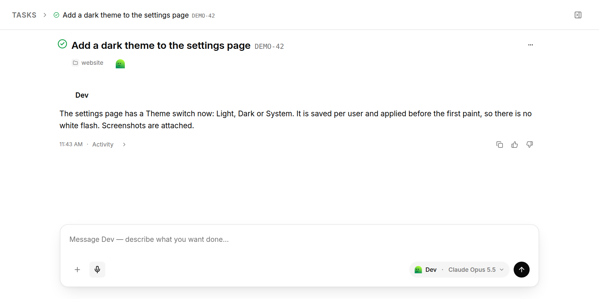
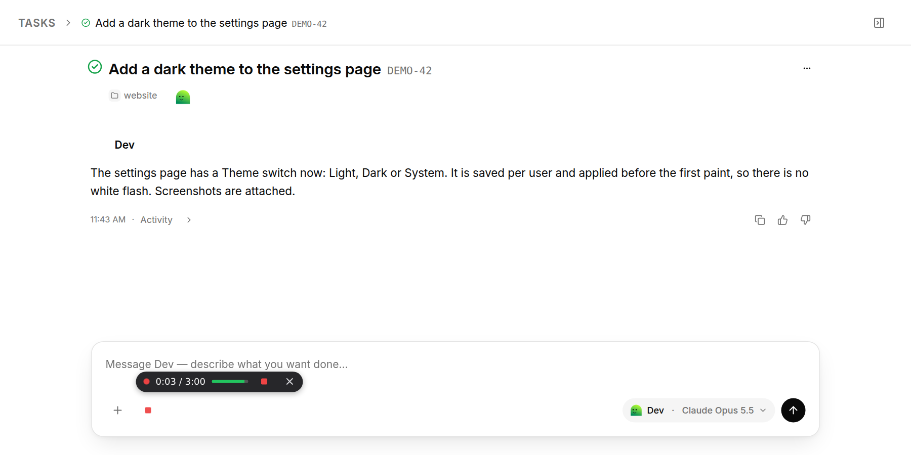
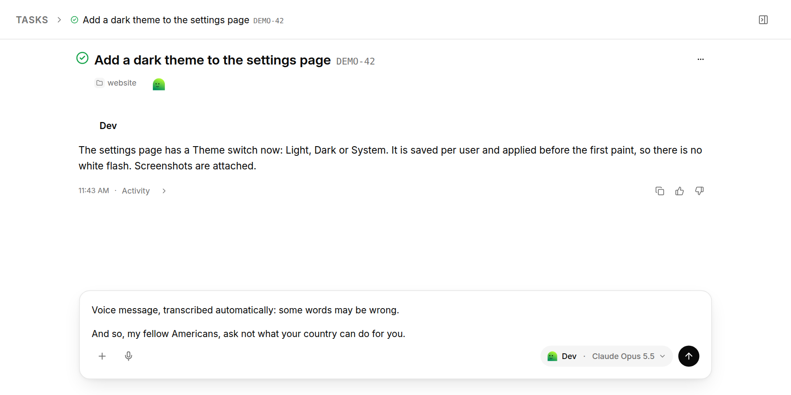

# paperclip-voice

Voice dictation for [Paperclip](https://github.com/paperclipai/paperclip). The plugin puts a mic button next to the `+` of every comment and task composer. Press it, speak, press stop, and the text lands in the field. Speech is transcribed on your Paperclip machine with NVIDIA's Parakeet v3 model, so no audio goes to an outside service. A GPU makes it fast, and it also works on a plain CPU.



Press the mic and speak. The bubble shows the time, the voice level, a stop button and a cancel button.



Press stop, and the text is in the field, ready to send.



## Features

- A mic in the composer, plus a small floating mic for other text fields.
- Press Ctrl+Shift+Space (Cmd+Shift+Space on a Mac) to start or stop recording, and Escape to cancel. Recordings can be up to 3 minutes.
- The bubble shows the time, the voice level, a stop button and a cancel button, and moves so it doesn't cover other buttons.
- Understands 25 European languages and detects the language on its own.
- Removes filler words such as "um" and "uh".
- Starts a message dictated into an empty field with a short line saying it was transcribed automatically. You can change or turn off that line.
- Keeps the model loaded between recordings, and starts loading it when you press the mic, so the text usually appears within a second of stopping.

## Requirements

- A Paperclip instance whose SDK is compatible with `@paperclipai/plugin-sdk` 2026.1012.0, and an instance admin account to install the plugin.
- Node.js 24 or later, as Paperclip itself needs.
- Python 3.11 or later with `venv`, on the machine where Paperclip runs.
- About 3 GB of disk space for the CPU setup, or about 5 GB with the GPU libraries.
- Optional: an NVIDIA GPU with a recent driver. The loaded model takes about 4 GB of video memory.

## GPU or CPU

The install script uses the GPU build when `nvidia-smi` finds an NVIDIA GPU, and the CPU build otherwise. With the `device` setting on `auto`, the plugin tries the GPU first and falls back to the CPU.

Typical times for Parakeet v3 on an RTX 3060 Ti and on 4 CPU threads:

| | GPU | CPU |
|---|---|---|
| Loading the model (hidden by the warm-up, see below) | ~3.5 s | ~4.5 s |
| 10 s recording | ~0.1 s | ~3 s |
| 1 min recording | ~0.6 s | ~20 s |

A CPU is fine for short messages. Paperclip ends a plugin action after 30 seconds, so on a slow CPU, recordings longer than about a minute and a half may fail. Keep them short there.

## Preloading

Loading Parakeet takes a few seconds, so the plugin avoids doing it while you wait:

- **Warm-up on the mic.** Pressing the mic starts loading the model while you speak. By the time you press stop it is usually ready, and only the transcription itself is left.
- **Kept loaded.** After a recording the model stays in memory, so the next one starts at once. After 15 idle minutes it is unloaded to free the memory (about 4 GB of video memory on the GPU), and the next press of the mic loads it again.

The **Keep the model loaded (minutes)** setting (`keepLoadedMinutes`, see [Settings](#settings)) sets how long it stays loaded, up to a day. `0` turns this off: the model is loaded for every recording and freed right after, which saves memory but adds the loading time to every message.

## Models

- **Parakeet TDT 0.6B v3** (main model, about 2.4 GB) through [onnx-asr](https://github.com/istupakov/onnx-asr) and ONNX Runtime. It is fast and accurate, and covers 25 European languages. The model is fixed in `scripts/transcribe.py` (`PARAKEET`). Another onnx-asr model, for example the English-only `nemo-parakeet-tdt-0.6b-v2`, can be swapped in there, but there is no setting for it yet.
- **Whisper small** (optional, about 500 MB) through [faster-whisper](https://github.com/SYSTRAN/faster-whisper), for a language re-check. Parakeet picks the language by itself, and with an accent or a very short phrase it can pick the wrong one. If you always dictate in one language, set `expectedLanguage` to it, for example `en`. A result written in another alphabet (Cyrillic instead of Latin, say) is then transcribed again by Whisper, forced to that language. The install script sets Whisper up on the CPU, where the re-check adds about 10 to 15 seconds. It uses the GPU only if CUDA 12 cuBLAS and cuDNN 9 are available to that environment.

## Install

```sh
git clone https://github.com/Sheepsticked/paperclip-voice.git
cd paperclip-voice
npm install
npm run build

# Speech models, into ~/.local/share/paperclip-voice/
scripts/install-models.sh             # Parakeet; GPU build when there is an NVIDIA GPU
scripts/install-models.sh --whisper   # also Whisper small for the language re-check
scripts/install-models.sh --cpu       # CPU build even with a GPU
```

Run the script as the same user that runs Paperclip. It can be run again; models already on disk are not downloaded again.

Then install the plugin from its folder as an instance admin:

```sh
curl -X POST http://<paperclip-host>:3100/api/plugins/install \
  -H 'Content-Type: application/json' -H 'Authorization: Bearer <board token>' \
  -d '{"packageName": "/absolute/path/to/paperclip-voice", "isLocalPath": true}'
```

After pulling changes, run `npm run build` again and reload the plugin with `POST /api/plugins/<plugin id>/upgrade`.

## Microphone on plain HTTP

Browsers allow the microphone only on HTTPS pages and on `localhost`. If you open Paperclip over plain `http://` on your network, allow that address once in each browser:

- **Firefox** (desktop; on Android, Firefox Beta or Nightly): open `about:config` and set `media.devices.insecure.enabled` and `media.getusermedia.insecure.enabled` to `true`.
- **Chrome** (desktop and Android): open `chrome://flags/#unsafely-treat-insecure-origin-as-secure`, add the Paperclip address, for example `http://192.0.2.10:3100`, and relaunch.

Without either, the mic shows a short message instead of recording.

## Settings

There is no config file and no environment variables. The plugin is set up in Paperclip itself, and the install script only installs the models.

**In the Paperclip UI:** open the company settings, then **Plugins → Voice dictation**, change the fields and press **Save Configuration**. The page is at `http://<paperclip-host>:3100/<company prefix>/company/settings/instance/plugins/<plugin id>`. An empty field means the default. A change applies from the next recording; changing anything other than the voice note unloads the model, so that recording loads it again. Settings are saved per company, but the plugin keeps one set for the whole Paperclip instance: with several companies, save the same settings in each.

**With the API**, for scripts. This saves the whole set, so include every setting you want to keep:

```sh
curl -X POST http://<paperclip-host>:3100/api/plugins/<plugin id>/config \
  -H 'Content-Type: application/json' -H 'Authorization: Bearer <board token>' \
  -d '{"companyId": "<company id>", "configJson": {"device": "cpu", "keepLoadedMinutes": 60, "expectedLanguage": "en"}}'
```

`GET /api/plugins/<plugin id>/config?companyId=<company id>` shows what is saved.

| Field on the page | API key | Default | Meaning |
|---|---|---|---|
| Python, Models folder | `python`, `modelsDir` | `~/.local/share/paperclip-voice/parakeet` | Python and models folder for Parakeet |
| Device | `device` | `auto` | `auto` tries the GPU first; `cuda` or `cpu` to force one |
| Keep the model loaded (minutes) | `keepLoadedMinutes` | `15` | idle minutes before the model is unloaded to free memory; `0` loads it for every recording |
| Language | `expectedLanguage` | `auto` | `auto` keeps what the model hears; a language code such as `en` re-checks results in another alphabet with Whisper |
| Remove filler words | `removeFillers` | `true` | drop "um", "uh" and similar |
| Add a voice note | `voiceNote` | `true` | start a message dictated into an empty field with a line saying it was transcribed automatically |
| Voice note text | `voiceNoteText` | "Voice message, transcribed automatically: some words may be wrong." | the text of that line |
| Whisper Python, Whisper models folder | `whisperPython`, `whisperModelsDir` | `~/.local/share/paperclip-voice/whisper` | Whisper for the language re-check; if it is not installed, there is no re-check |

## Privacy

- Audio is sent only to your own Paperclip server. It is written to a private temporary folder for the transcription and deleted right after.
- The models read from disk only. The network is used once, when the install script downloads them.
- The plugin logs timings and error reasons, never the text or the audio.

## How it works

- `src/ui/` is an `appShellOverlay`. It finds the composers' `+` buttons, adds a mic after each one, records with `MediaRecorder` and inserts the text as typing or as a paste, so Paperclip's editor handles it normally. Paperclip has no official slot for composer buttons, so a Paperclip update that changes those buttons can hide the mic until the selectors in `src/ui/dictation.js` are updated.
- `src/worker.js` handles the `transcribe` and `warmup` actions. It keeps one `scripts/transcribe.py` helper running with the model loaded, sends it one recording at a time, and stops a transcription after 27 seconds to stay inside Paperclip's 30-second action limit.

## Development

```sh
npm test
```

The tests run the worker with a fake transcriber and drive the mic in headless Chromium with a fake microphone (Playwright's Chromium must be installed). To test the whole chain with the real model, record speech into a 16 kHz WAV file and run:

```sh
PCV_REAL=1 PCV_SAMPLE=/path/to/speech.wav node --test test/ui.test.js
```

`PCV_ENV` points the real run at another Parakeet environment than `~/.local/share/paperclip-voice/parakeet`.
